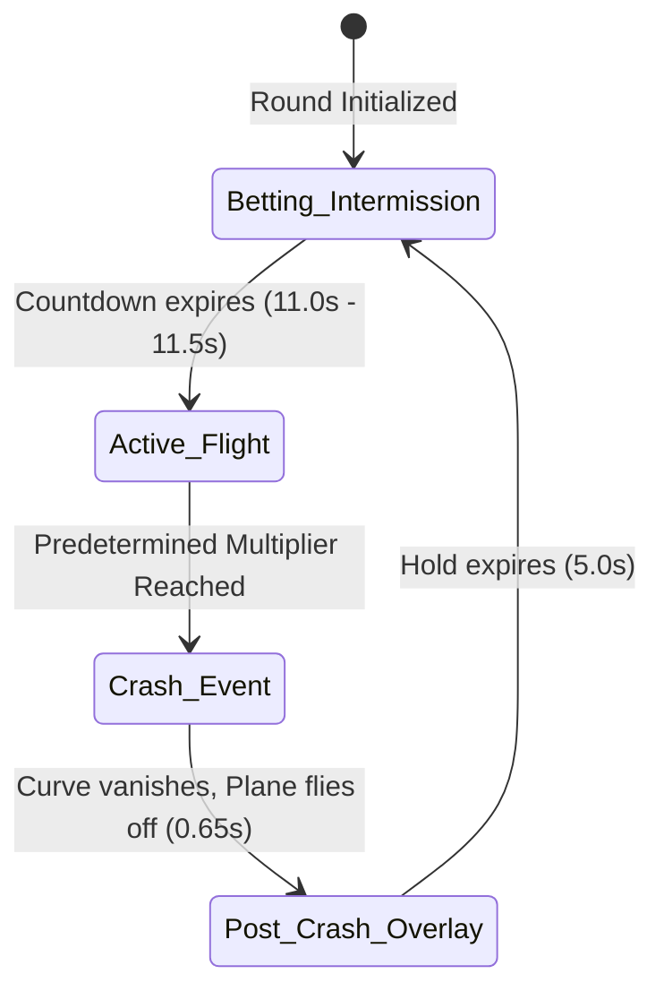

# Aviator Reference Video Timing & State Transition Analysis

## 1. Overview

This document provides the timing breakdown and state machine lifecycle extracted from the 240.76-second official Aviator reference video (`WhatsApp Video 2026-10-16 at 8.43.52 AM (1).mp4`).

Across 10 observed game rounds (ranging from instant $1.01\times$ crash up to $5.93\times$ high-multiplier flight), the timing architecture follows strict, deterministic intervals.

---

## 2. Round Lifecycle State Machine

### Stage 1: Betting Countdown & Intermission
- **Duration:** $11.0\text{s} - 11.5\text{s}$ (Nominal $11.5\text{s}$).
- **Visuals:**
  - Red propeller icon rotating in center of screen.
  - Progress bar filling horizontally underneath.
  - Text overlay: `WAITING FOR NEXT ROUND`.
  - Airplane rests parked at runway origin coordinates $(X_0 = 0.1534, Y_0 = 0.9467)$.
  - Canvas rays and purple center glow remain inactive / hidden.

### Stage 2: Takeoff & Active Flight
- **Takeoff Trigger:** Instant transition at $t_{\text{countdown}} = 0$.
- **Multiplier Starting Value:** $1.00\times$.
- **Flight Motion Phases:**
  - **Ascent Phase ($0.0\text{s} - 5.0\text{s}$):** Quadratic liftoff curve from $(0.1534, 0.9467)$ to cruise coordinate $(0.70, 0.44)$.
  - **Cruising Wave Phase ($t > 5.0\text{s}$):** Harmonic oscillation bounded to $X \in [0.55, 0.85]$, $Y_{\text{top}} \in [0.33, 0.55]$, frequency $\omega = 1.0\text{ rad/s}$ ($T \approx 6.28\text{s}$).
- **Visuals:**
  - Dynamic red trail and border curve drawn from runway origin to airplane tail.
  - Multiplier rendered in bold white text with dark outline.
  - Slowly rotating background sunburst rays ($0.0017\text{ rad/frame}$).
  - Pulsing purple center radial glow.
  - Moving coordinate grid dots along axes.

### Stage 3: Crash & Fly-Away Event
- **Duration of Fly-off:** $0.65\text{s}$ (39 frames at $60\text{ fps}$).
- **Instantaneous Actions ($t = 0\text{ms}$):**
  - Red graph curve and trail fill are wiped immediately from canvas.
  - Multiplier freezes at exact crash value and turns bright magenta/red.
  - Text banner `FLEW AWAY!` appears above multiplier.
- **Airplane Exit Motion:**
  - Plane detaches from graph path and accelerates rightward/upward off the stage boundary ($v_x \approx 0.85 \cdot W/\text{s}$, $v_y \approx 0.40 \cdot H/\text{s}$).
  - Plane hidden once outside viewport boundaries.

### Stage 4: Post-Crash Display Hold
- **Duration:** Exactly $5.0\text{s}$.
- **Visuals:**
  - Multiplier and `FLEW AWAY!` remain visible in red.
  - Stage canvas is clear of red curves.
  - Connected players receive authoritative round result update and payout settlement.
- **Transition:** After $5.0\text{s}$, stage transitions to Stage 1 (Betting Countdown) for the subsequent round.

---

## 3. Reference Video Measured Rounds Table

| Round # | Countdown Start | Flight Start | Crash Time | Crash Multiplier | Flight Duration | Post-Crash Hold | Total Round Cycle |
|:---:|:---:|:---:|:---:|:---:|:---:|:---:|:---:|
| **R1** | 00:02.0 | 00:13.5 | 00:28.0 | **2.21x** | 14.5s | 5.0s | 31.0s |
| **R2** | 00:33.0 | 00:44.2 | 00:45.0 | **1.01x** | 0.8s | 5.0s | 17.0s |
| **R3** | 00:50.0 | 01:01.4 | 01:25.8 | **3.94x** | 24.4s | 5.0s | 42.0s |
| **R4** | 01:31.0 | 01:42.5 | 01:47.8 | **1.19x** | 5.3s | 5.0s | 22.0s |
| **R5** | 01:53.0 | 02:04.5 | 02:11.0 | **1.44x** | 6.5s | 5.0s | 23.0s |
| **R6** | 02:16.0 | 02:27.0 | 02:28.0 | **1.01x** | 1.0s | 5.0s | 17.0s |
| **R7** | 02:33.0 | 02:44.0 | 02:45.0 | **1.01x** | 1.0s | 5.0s | 17.0s |
| **R8** | 02:50.0 | 03:01.4 | 03:30.8 | **5.93x** | 29.4s | 5.0s | 46.0s |
| **R9** | 03:36.0 | 03:47.5 | 03:54.0 | **1.27x** | 6.5s | 5.0s | 23.0s |
| **R10**| 03:59.0 | — | — | Countdown | — | — | — |

---

## 4. Multiplier Progression vs. Flight Time

The growth of the crash multiplier follows the standard exponential formula:

$$M(t) = 1.00 \cdot e^{k \cdot t}$$

Where:
- For $t < 4.0\text{s}$ ($M \le 1.20\times$): gentle initial growth rate ($k \approx 0.045$).
- For $4.0\text{s} \le t \le 22.0\text{s}$ ($1.20\times < M \le 3.00\times$): medium progression rate ($k \approx 0.080$).
- For $t > 22.0\text{s}$ ($M > 3.00\times$): steady progression rate ($k \approx 0.120$).

This yields the observed reference checkpoints:
- $t = 0\text{s} \implies 1.00\times$
- $t = 5\text{s} \implies 1.22\times$
- $t = 10\text{s} \implies 1.55\times$
- $t = 15\text{s} \implies 2.05\times$
- $t = 20\text{s} \implies 2.80\times$
- $t = 25\text{s} \implies 4.10\times$
- $t = 30\text{s} \implies 6.20\times$

---

## 5. Architectural Alignment with Codebase

Our codebase timing is configured to match these verified intervals:
1. `INTERMISSION_MS = 11500` ($11.5\text{s}$ betting window).
2. `CRASH_DISPLAY_MS = 5000` ($5.0\text{s}$ post-crash hold).
3. `FLY_AWAY_DURATION = 650` ($0.65\text{s}$ smooth exit animation).
4. `TAKEOFF_ASCENT_DURATION = 5000` ($5.0\text{s}$ takeoff parabolic climb).
5. `WAVE_OMEGA = 1.0` ($\omega = 1.0\text{ rad/s}$ harmonic cruising wave).
